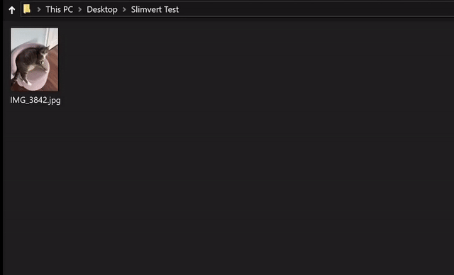

# Slimvert

Convert video, audio and images directly from Windows Explorer. Choose your usual
formats once, then convert with a right-click. Your originals are preserved.

**Windows 11 x64 · Portable alpha · [Download Slimvert](https://github.com/mkk126/Slimvert-public/releases/download/v0.1.0-alpha.1/Slimvert-0.1.0-alpha.1-win-x64.zip)**

## Get started

1. Download **Slimvert-0.1.0-alpha.1-win-x64.zip** from Releases.
   Choose the application ZIP, not GitHub's **Source code** download.
2. Extract the whole folder and open **Slimvert.exe**. Everything needed is included.
3. In Settings, enable **Show Slimvert in Explorer** and Save.
4. Right-click a file or folder, choose **Show more options > Slimvert**, then a format.

Before moving or deleting Slimvert, disable its Explorer integration in Settings.
Extract updates into a separate folder and keep the old copy until the new one works.

Report problems in Issues. Remove private paths and filenames before sharing logs.
This unsigned alpha may trigger Windows warnings; do not disable security protection.

[MIT license](LICENSE). FFmpeg and .NET notices are included with the app.
Matching FFmpeg source downloads accompany the release; they are optional for use.
